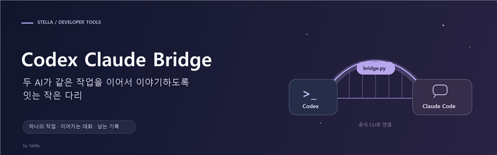
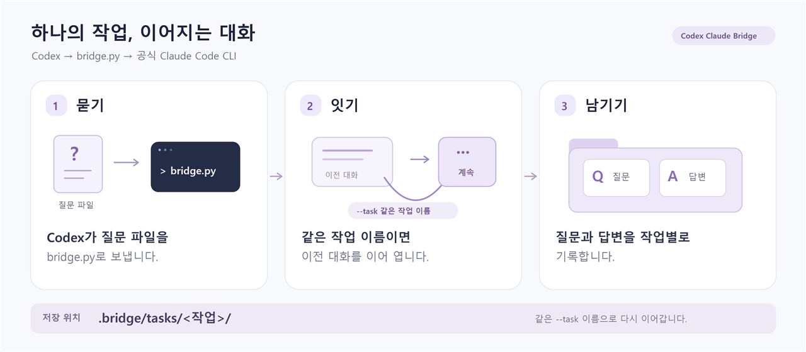
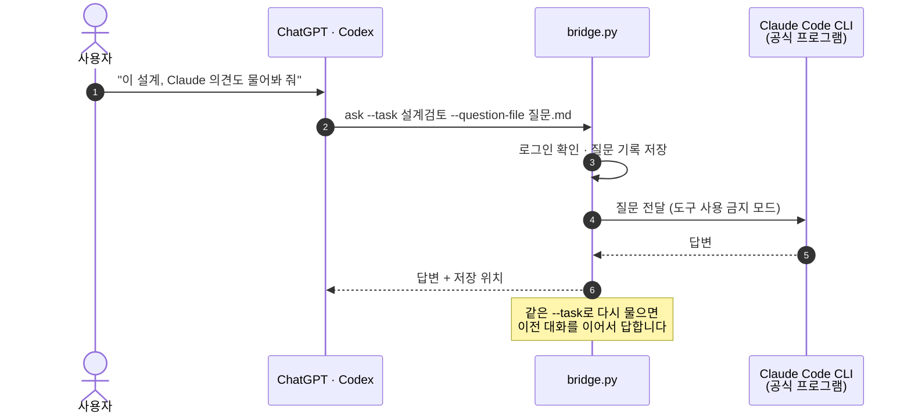
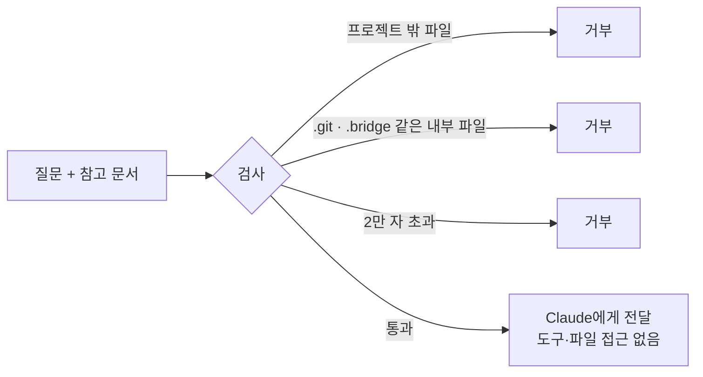

<p align="center">
  
</p>

<p align="center">
  <b>ChatGPT/Codex가 Claude에게 질문하고, 같은 작업의 대화를 이어갈 수 있게 해 주는 터미널 도구.</b><br>
  파이썬 파일 하나 · 외부 패키지 없음 · API 키 없음
</p>

<p align="center">
  
  
  
</p>

---

## 한눈에 보기

AI 두 개를 함께 쓰면 늘 같은 문제가 생깁니다. **한쪽이 한 이야기를 다른 쪽은 모릅니다.**
결국 사람이 대화를 복사해서 옮겨 붙이게 되죠.

Codex Claude Bridge는 그 복사·붙여넣기를 대신합니다.

| | 이전 | 이후 |
|---|---|---|
| 질문 전달 | 사람이 직접 복사해서 붙여넣기 | 명령 한 줄 |
| 이전 대화 | 매번 처음부터 다시 설명 | 작업 이름만 같으면 자동으로 이어짐 |
| 기록 | 채팅창에 흩어짐 | 작업별 폴더에 질문·답변이 정리됨 |

---

## 작동 방식

<p align="center">
  / 에 기록합니다" width="100%">
</p>

<details>
<summary><b>한 번의 질문이 오가는 순서 자세히 보기</b></summary>



</details>

세 단계로 정리하면 이렇습니다.

1. **묻기** — Codex가 질문을 파일로 써서 `bridge.py ask`로 보냅니다.
2. **잇기** — 작업 이름(`--task`)마다 대화 번호를 기억해 두었다가, 다음 질문 때 그 대화를 이어 엽니다.
3. **남기기** — 질문과 답변이 `.bridge/tasks/<작업>/` 아래에 차례대로 저장됩니다. 나중에 누가 무엇을 물었는지 바로 확인할 수 있습니다.

---

## 시작하기

**준비물:** Python 3.9 이상, 그리고 로그인된 [Claude Code CLI](https://code.claude.com/docs/en/cli-reference).

```bash
# 1. 연결 상태 확인
python -B -X utf8 bridge.py status

# 2. 질문 보내기
python -B -X utf8 bridge.py ask --task my-task --question-file questions/connection-check.md

# 3. 같은 작업으로 이어서 묻기
python -B -X utf8 bridge.py ask --task my-task --question-file questions/resume-check.md

# 4. 지금까지의 기록 보기
python -B -X utf8 bridge.py history --task my-task
```

참고 문서를 함께 보내고 싶다면 `--context 파일.md`를 붙이세요. 최대 4개, 합쳐서 2만 자까지 보낼 수 있습니다.

<details>
<summary><b>명령어 전체 보기</b></summary>

| 명령 | 하는 일 |
|---|---|
| `status` | Claude CLI 위치와 로그인 상태를 보여 줍니다 |
| `ask --task <이름> --question-file <파일>` | 질문을 보내고 답을 저장합니다 |
| `ask ... --context <파일>` | 참고 문서를 함께 보냅니다 (여러 번 사용 가능) |
| `ask ... --new-session` | 이전 대화를 잇지 않고 새로 시작합니다 |
| `ask ... --timeout <초>` | 응답 대기 시간 (10~300초, 기본 120초) |
| `history --task <이름>` | 해당 작업의 질문·답변 기록을 보여 줍니다 |

</details>

---

## 안전하게 설계했습니다

연결 도구는 편리한 만큼 조심해야 합니다. 이 도구는 **할 수 있는 일을 일부러 좁게** 만들었습니다.



- 🔑 **API 키를 쓰지 않습니다.** 공식 CLI의 기존 로그인만 사용하고, 인증 정보를 읽거나 복사하지 않습니다.
- 🧰 **Claude는 답변만 합니다.** 파일 수정, 명령 실행, 다른 AI 호출 같은 도구 사용을 모두 끈 상태로 묻습니다.
- 📁 **보낼 파일은 직접 고릅니다.** 폴더 통째로 보내지 않고, 지정한 `.md`·`.txt` 파일만 보냅니다.
- 🔁 **실패해도 다시 보내지 않습니다.** 오류가 나면 그대로 멈추고 기록을 남깁니다. 다시 시작할지는 사람이 정합니다.
- 🔒 **한 작업에 한 번에 한 질문만.** 같은 작업이 동시에 실행되지 않도록 잠금을 겁니다.
- 🙈 **기록은 내 컴퓨터에만.** `.bridge/` 폴더는 Git에서 제외되어 공개 저장소에 올라가지 않습니다.

---

## 지금 되는 것과 아직 안 되는 것

| 기능 | 상태 |
|---|---|
| Codex → Claude 질문 보내기 | ✅ 실제 연결로 확인 |
| 같은 작업 대화 이어가기 | ✅ 실제 연결로 확인 ([검증 기록](VALIDATION_TERMINAL_2026-11-15.md)) |
| 오프라인 자동 테스트 | ✅ 13개 통과 |
| Claude → Codex 반대 방향 | ✅ 별도 프로그램(codex-mcp)으로 동작 확인 · 이 저장소에는 아직 포함하지 않음 · 대화 이어가기 없음 |
| 이미 열려 있는 채팅창에 바로 연결 | ✖ 지원하지 않음 (작업마다 별도 대화를 엽니다) |

> [!NOTE]
> 질문할 때마다 Claude 구독 사용량이 조금씩 들어갑니다. 비용이나 토큰이 얼마나 줄어드는지는 아직 측정하지 않았습니다.

---

## 테스트

```bash
python -B -X utf8 test_bridge.py -v
```

가짜 클라이언트로 실행하므로 인터넷도 로그인도 필요 없습니다. 이 테스트의 답변은 가짜이며, 실제 연결 결과는 [검증 기록](VALIDATION_TERMINAL_2026-11-15.md)에 따로 정리했습니다.

---

## 폴더 구성

```text
.
├── bridge.py                  # 연결 프로그램 본체
├── test_bridge.py             # 오프라인 테스트 13개
├── questions/                 # 보낼 질문 파일
├── BRIDGE_GUIDE.md            # 자세한 사용 설명
├── CONNECTION_STATUS.md       # 연결 상태 기록
├── VALIDATION_TERMINAL_*.md   # 실제 연결 검증 기록
└── docs/
    ├── PROJECT_NOTES.md       # 개발 메모
    └── assets/                # 그림 파일
```

---

<p align="center">
  Made by <a href="https://github.com/Lunalumen">Stella</a> 🌙
</p>
