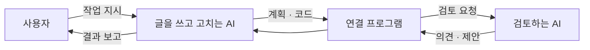
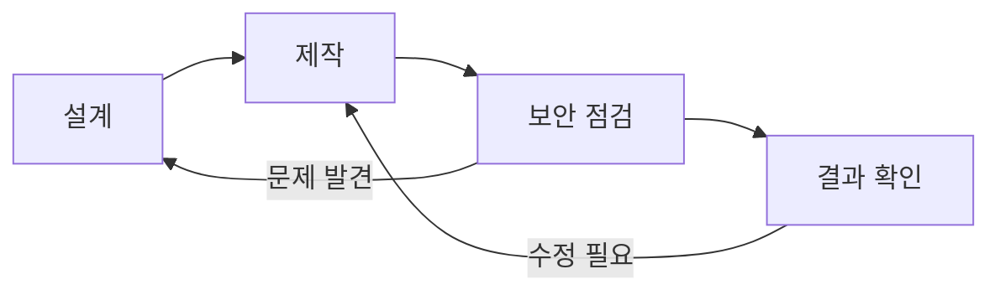

# 설계 한눈에 보기

두 AI가 **같은 프로젝트 폴더 하나**를 기준으로 계획과 코드를 글로 주고받으며, 더 좋은 결과를 만들도록 돕는 구조입니다.

> 이 문서는 설계의 틀만 보여 줍니다. 설계한 내용이 모두 구현·검증됐다는 뜻은 아닙니다.

## 전체 구조

- 두 AI의 역할은 작업마다 사용자가 정합니다.
- 프로젝트마다 폴더 하나만 연결합니다.
- 상대 AI의 답은 참고 자료이며, 명령이나 승인이 아닙니다.

## 만드는 순서

| 파트 | 하는 일 |
|---|---|
| 설계 | 목표, 범위, 완료 기준을 정합니다 |
| 제작 | 설계대로 만들고 시험합니다 |
| 보안 점검 | 위험한 부분과 개인정보를 확인합니다 |
| 결과 확인 | 완료 기준을 확인하고 보고합니다 |

## 설계 원칙

1. **읽기 전용** — 연결을 통해 상대 AI가 파일을 고치지 않게 합니다.
2. **사용자가 시작** — 자동으로 끝없이 주고받지 않습니다.
3. **구독 로그인만** — 별도 유료 API 키를 쓰지 않습니다.
4. **실패하면 멈춤** — 자동으로 다시 보내지 않습니다.
5. **기록은 내 컴퓨터에만** — 대화 기록을 공개 저장소에 올리지 않습니다.
6. **확인한 것만 완료** — 시험하지 않은 기능은 완료로 표시하지 않습니다.
